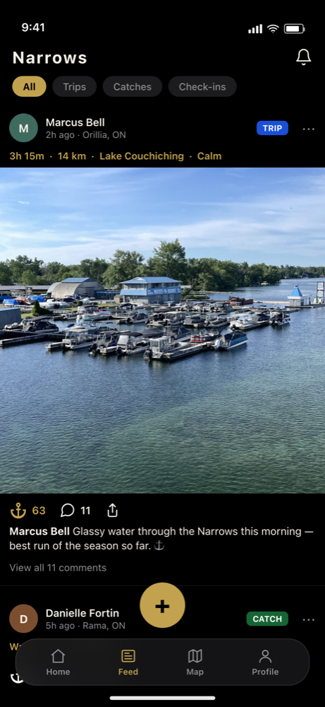

# Narrows

A navigation and social app for boaters on the waters of Simcoe County, Ontario: Lake Simcoe, Lake Couchiching, the Narrows and Sparrow Lake.



## What it does

- **Live conditions.** Wind, gusts, precipitation and feels-like temperature on the map.
- **Local map.** Marinas, place search, catch pins that cluster as you zoom, and offline map areas you can download.
- **Shallow-water alerts.** Uses your boat's draft and local depth data to warn you before you run aground.
- **Trip tracking.** Record a route, then save it to My Trips or post it to the feed.
- **Social feed.** Trips, catches and check-ins from other local boaters, with comments and sharing.
- **Marina tools.** Marina profiles, bookings, photos and hours.
- **Sign in** with Apple, Google or email.

## Tech stack

| Layer | Tech |
| --- | --- |
| App | React Native, Expo SDK 54, TypeScript |
| Navigation | React Navigation (bottom tabs + native stack) |
| Maps & location | react-native-maps, expo-location, expo-task-manager |
| Backend | Supabase (auth, Postgres, storage, edge functions) |
| Payments | Stripe (`@stripe/stripe-react-native`) |
| Weather | Open-Meteo |
| Builds | EAS Build (iOS-first, Android configured) |

## Run it

You need Node.js and either Xcode (iOS) or Android Studio (Android).

```bash
npm install
npx expo run:ios      # or: npx expo run:android
```

The app uses native modules (Apple/Google sign-in, Stripe, maps), so it runs as an Expo **development build**. Expo Go won't work. After the first native build, start the dev server with:

```bash
npm start
```

The database schema and migrations are SQL files in `supabase/`. The edge functions are in `supabase/functions/`.
